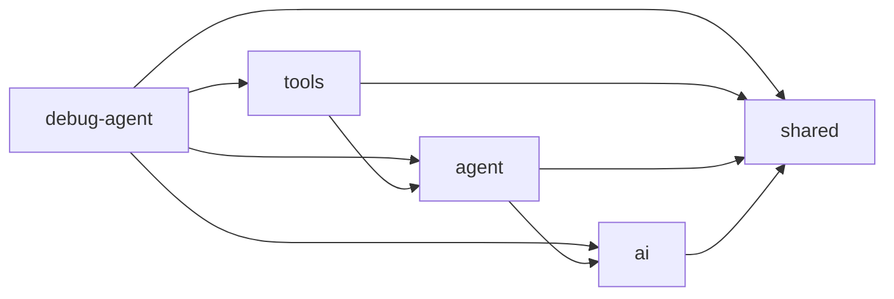

# Mini Agent Run 排查台

## 项目简介与核心特性

Mini Agent Run 排查台用于调查本地 Agent 轨迹与日志。选择文件或目录后，可以自由提问、观察工具调用和流式回答、停止或重跑调查，并从结论回跳证据行。右栏支持大日志分页、搜索和首错定位。

Vue 3 前端通过 HTTP 和 SSE 连接 Fastify 后端。核心采用 Pi 风格的消息、状态、事件和取消机制。图中箭头从包指向其工作区依赖，共五个包。



SQLite 将数据持久化在 `sessions`、`investigation_runs`、`run_events` 和 `artifacts` 四张业务表中。超长工具输出落库后按需回读。删除会话会级联清理对应的数据库记录，磁盘日志原件保留。

- API Key 由本地配置提供，服务端对错误和持久化输出脱敏。`.env` 由 Git 忽略。
- 前端按文本展示日志，通过禁用 `v-html` 防止轨迹内容注入 HTML。
- 文件浏览受 `ALLOWED_TRACE_ROOTS` 配置约束，并拦截敏感路径和评测标准答案目录。创建会话后，文件读取限于绑定的文件或目录。

## 环境要求与本地启动

使用 Node.js 24 LTS（24.11.0 或更新的 24.x）及 npm。当前锁文件已在 Node.js 24.11.0 通过完整门禁，CI 也使用 Node.js 24。早期方案中的 Node.js 20.0.0 会在 Fastify 加载锁定的 ESM 依赖时触发 `ERR_REQUIRE_ESM`。

在仓库根目录执行以下命令，先确认 `node --version` 符合上述要求，再安装依赖：

```powershell
node --version
npm install
Copy-Item .env.example .env
```

在 Bash 中可用 `cp .env.example .env`。已有 `.env` 时直接编辑现有文件。模板配置了 `LLM_BASE_URL=https://api.deepseek.com` 与 `LLM_MODEL=deepseek-flash`，在 `.env` 填写 `LLM_API_KEY` 即可发起真实排查。也可以在页面左栏的「设置」中保存 API Key。浏览器会将它保存到当前站点的 `localStorage`，发起调查或重跑时优先使用它覆盖服务端配置的 Key。

```powershell
npm run dev
```

默认后端在 `127.0.0.1:3001`，打开前端 `http://localhost:5173`。内置样例位于 `data/fixtures/diagnostic-demo`。`ALLOWED_TRACE_ROOTS=*` 默认允许浏览本机可访问的文件夹和盘符，敏感文件、目录和 `Database/offline-eval` 返回 403。部署时可在 `.env` 将该值配置为逗号分隔的目录列表，重启后按白名单限制浏览。

## 三组体验路径与开放式提问

从左栏新建会话。可逐级浏览目录，也可在地址栏粘贴文件或目录路径自动跳转。支持的单文件会在父目录中定位。点击左上角标题可自定义名称，默认使用目标文件夹或文件名。创建后在输入框直接提问。

1. **大日志与停止、重跑**。选择 `data/fixtures/diagnostic-demo` 目录。提问「检查 `noisy-large-xss.log` 的第一个错误，引用原文行号并给出下一步」。在右栏切换到该文件后，可搜索 `<script` 或跳到首错。保留默认 `TOOL_MODE=mock`，再问「请运行慢速运行时诊断，使用 slow 场景，持续 10 秒，每 500 毫秒汇报」。等工具开始运行后点击停止，再点重跑。
2. **成败轨迹对照**。在同一目录会话提问「比较 `agent-run-failed.jsonl` 与 `agent-run-passed.jsonl`，找出最早出现的关键差异，引用两份文件的行号，并分别说明终止原因、是否有工具错误和任务结果」。
3. **真实长轨迹与追问**。如果已配置本地数据，可选择 `TrajErrBench/train` 下的一份轨迹。也可从可访问目录选取本地 `.json`、`.jsonl`、`.log` 或 `.txt`。先问「任务在哪一步偏离预期？按时间顺序列出支持判断的证据」，再问「从刚才的首错往前读几行，有没有更早的异常？」。点击结论里的证据回看原文。

## 自动化门禁与 CLI

- `npm run verify` 依次运行类型检查、ESLint、仓库护栏、确定性测试和构建。测试使用离线模型替身。
- `npm run verify:ui` 在本地 Chromium 上独立运行离线浏览器性质测试。先执行 `npm run build`。脚本可复用系统 Edge 或 Chrome，也可用 `PLAYWRIGHT_CHROMIUM_EXECUTABLE_PATH` 指定本地可执行文件。
- `npm run verify:ui -- --seed 20261125 --runs 5 --steps 12` 显式指定种子、轮数和每轮步数，默认即为这组参数。

下列子命令均支持 `--help` 和 `--json`。

| 命令 | 用途 |
| --- | --- |
| `npm run cli -- env-check` | 核对 Node、锁文件和环境模板 |
| `npm run cli -- guardrails` | 运行仓库护栏检查 |
| `npm run cli -- smoke` | 检查 HTTP 健康端点与 SQLite |
| `npm run cli -- graph` | 查看 Feature Graph 阶段及覆盖 |
| `npm run cli -- tools-smoke` | 检查七工具和 Artifact，默认使用内置夹具。可附加 `--path <dir>` |
| `npm run cli -- llm-smoke` | 用本地凭证向真实模型发送短请求，消耗模型 API 配额 |
| `npm run cli -- e2e-smoke` | 离线验证多轮调查、Artifact 回读、停止、重跑、重启恢复和删除隔离 |

## Vibe Coding 实践复盘

- M0 先跑通完整门禁，把类型、Lint、护栏、测试和构建变成可重复命令。
- G-01 用严格类型发现跨层数据不一致，G-02 在 Lint 阶段拦截 `any` 和不安全的 HTML 渲染。
- G-03 同时检查导入名、真实文件位置和 workspace 清单，捕获链接指向的越界依赖。
- G-04 用 Git 跟踪状态与模板检查保护本地凭证，G-05 用确定性规则拦截抑制注释和跳测。
- G-06 同时校验工作树与索引中的图谱标识，用反例证明缺少覆盖会拦截门禁。
- G-07 在工具读取边界隔离 TrajErrBench 人工标注，让模型根据轨迹本身取证。
- Feature Graph 先登记功能，再按阶段推进必需节点，最终核对 12 个节点与测试的对应关系。
- 用同一棵已验证的 Git 树做原子提交，交接时以功能节点、验收证据和动态状态恢复上下文。
- 对并发状态机用轻量 TLA+ 描述不变式，并用属性测试验证实际服务行为。
- Lean 4 熔断后采用严格类型和 `fast-check`，pnpm 熔断后采用 npm workspaces。
- Bombadil 在当前 Windows 环境受阻，采用 Playwright 与 `fast-check` 在真实浏览器复测。
- 独立双盲复检用干净副本和负对照检验交付断言，也保留真实模型的脱敏调用回执。
